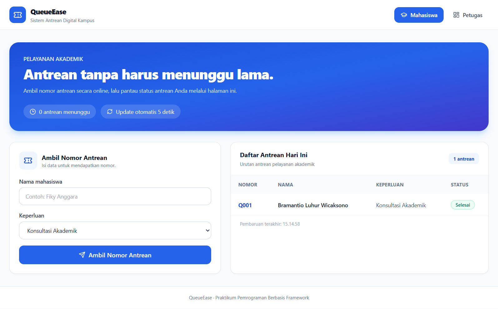
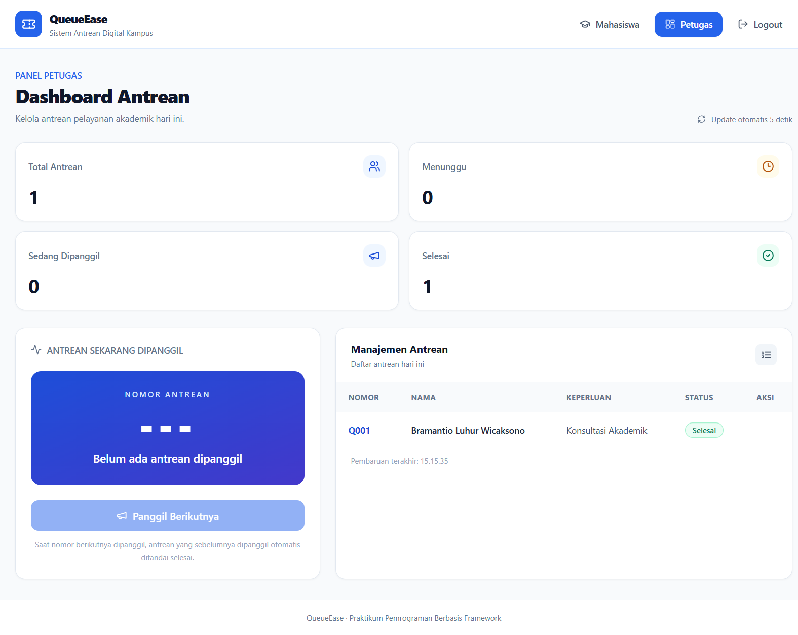

# QueueEase – Smart Queue

Aplikasi antrean digital kampus untuk membantu mahasiswa mengambil nomor antrean secara online dan petugas mengelola antrean melalui dashboard.

Dibangun menggunakan **React, Vite, Tailwind CSS, Express.js, dan PostgreSQL (Supabase)**.

## Tampilan Aplikasi

### Halaman Mahasiswa


### Dashboard Petugas


## Fitur

- Mahasiswa dapat mengambil nomor antrean dan melihat status antrean.
- Petugas dapat login dan mengelola antrean.
- Memanggil antrean berikutnya dan menyelesaikan antrean.
- Statistik antrean harian.
- Pembaruan data otomatis setiap 5 detik.
- Nomor antrean harian dengan format Q001, Q002, dan seterusnya.

## Teknologi

| Bagian | Teknologi |
|---|---|
| Frontend | React, Vite, Tailwind CSS |
| Backend | Node.js, Express.js |
| Database | PostgreSQL (Supabase) |
| Autentikasi | JWT |

## Persiapan

Pastikan sudah tersedia:

- [Node.js](https://nodejs.org/)
- [Visual Studio Code](https://code.visualstudio.com/)
- [Akun Supabase](https://supabase.com/)

PostgreSQL tidak perlu diinstal secara lokal karena database menggunakan Supabase.

## Instalasi dan Konfigurasi

### 1. Clone atau extract project

Buka folder `queueease-supabase` di VS Code.

### 2. Siapkan database Supabase

1. Buat project baru melalui [Supabase Dashboard](https://supabase.com/dashboard).
2. Buka **SQL Editor**.
3. Jalankan seluruh isi file `database/schema.sql`.
4. Pastikan tabel `public.antrean` sudah tersedia di Table Editor.
5. Buka menu **Connect**, pilih **Session Pooler** dan format **URI**.
6. Salin connection string untuk konfigurasi backend.

### 3. Konfigurasi backend

Buka terminal di VS Code:

```bash
cd backend
npm install
```

Salin `.env.example` menjadi `.env`.

PowerShell:

```powershell
Copy-Item .env.example .env
```

Isi `backend/.env` menggunakan konfigurasi berikut:

```env
PORT=5000
ADMIN_USERNAME=admin
ADMIN_PASSWORD=admin123
JWT_SECRET=GANTI_DENGAN_SECRET_ACAK_PANJANG
DATABASE_URL=ISI_CONNECTION_STRING_SUPABASE
```

Ganti `DATABASE_URL` dengan connection string asli dari Supabase dan gunakan JWT secret yang panjang serta unik.

Jangan membagikan atau mengunggah file `.env` ke GitHub.

### 4. Jalankan backend

Dari folder `backend`:

```bash
npm run dev
```

Backend berjalan di:

`http://localhost:5000`

### 5. Jalankan frontend

Buka terminal baru di VS Code:

```bash
cd frontend
npm install
npm run dev
```

Buka alamat yang ditampilkan Vite, biasanya:

`http://localhost:5173`

## Halaman Aplikasi

| Halaman | URL |
|---|---|
| Mahasiswa | `http://localhost:5173/` |
| Login Petugas | `http://localhost:5173/admin/login` |
| Dashboard Petugas | `http://localhost:5173/admin` |

Gunakan username dan password admin yang sudah dikonfigurasi di `backend/.env`.

## Struktur Project

```text
queueease-supabase/
├── backend/
│   ├── src/
│   ├── .env.example
│   └── package.json
├── database/
│   └── schema.sql
├── docs/
│   └── screenshots/
├── frontend/
│   ├── src/
│   └── package.json
└── README.md
```

## Menjalankan Kembali

Jalankan backend dan frontend melalui dua terminal terpisah:

**Terminal 1 – Backend**
```bash
cd backend
npm run dev
```

**Terminal 2 – Frontend**
```bash
cd frontend
npm run dev
```

## Catatan

- Database menggunakan Supabase PostgreSQL.
- Backend berkomunikasi dengan database menggunakan connection string yang disimpan di `.env`.
- Autentikasi petugas menggunakan JWT dengan masa sesi 8 jam.
- Data diperbarui melalui polling setiap 5 detik.
- Kredensial admin bawaan ditujukan untuk praktikum. Ganti password sebelum aplikasi digunakan secara publik.
- Jangan pernah commit file `.env` atau membagikan kredensial database.

## Identitas Kelompok

**Kelompok 4**

| No. | Nama | NIM |
|---:|---|---|
| 1 | Galang Surya Nata Budi Kesumah | 202412043 |
| 2 | Muhammad Aditya Januar | 202412049 |
| 3 | Nur Halimatul Sa Diah | 202312015 |
| 4 | Bramantio Luhur Wicaksono | 202412002 |
| 5 | Khoirum Nurfatikha Amin | 202412030 |